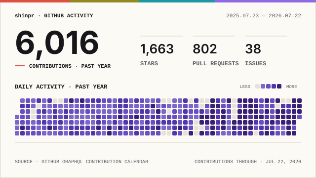
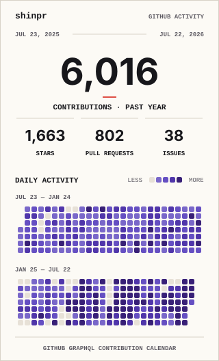

# GitHub Profile Stats

A zero-runtime-dependency GitHub Action that generates static SVG cards for your GitHub profile. Each run renders the same validated snapshot, including a full 365- or 366-day contribution history and current public metrics, as wide and compact cards in light and dark. The provided workflow commits all four variants to the profile repository, so no hosted renderer is required.

## Card previews

<div align="center">
  <picture>
    <source media="(prefers-color-scheme: dark)" srcset="./assets/signal-field-wide-dark.svg">
    
  </picture>
</div>

<details>
<summary>Compact card</summary>

<div align="center">
  <picture>
    <source media="(prefers-color-scheme: dark)" srcset="./assets/signal-field-compact-dark.svg">
    
  </picture>
</div>

</details>

The preview SVGs are generated by the renderer and should not be edited by hand.

## Output model

The `theme` input selects a registered renderer and defaults to `signal-field`. Each run always produces both layouts in both color schemes:

| Layout | Color scheme | Filename |
|--------|--------------|----------|
| `wide` | `light` | `signal-field-wide-light.svg` |
| `wide` | `dark` | `signal-field-wide-dark.svg` |
| `compact` | `light` | `signal-field-compact-light.svg` |
| `compact` | `dark` | `signal-field-compact-dark.svg` |

Layout and color scheme are intentionally not Action inputs. Generating the complete four-file set keeps publication atomic and lets the consuming README choose a layout while `<picture>` follows the reader's preferred color scheme.

## Metrics

- `CONTRIBUTIONS`: official GitHub GraphQL contribution-calendar counts for the inclusive past year (365 or 366 UTC dates). Exact parity with GitHub's profile HTML is not promised.
- `STARS`: sum across owned public repositories.
- `PULL REQUESTS`: the all-time authored-public count reported by GitHub REST Search.
- `ISSUES`: the all-time authored-public count reported by GitHub REST Search.

GitHub REST Search examines at most 4,000 repositories matching a query. The pull-request and issue values therefore report GitHub Search results within that official scope; they are not an independent exhaustive crawl. See [GitHub's search scope limits](https://docs.github.com/en/rest/search/search#search-scope-limits).

The supported credential is the calling workflow's `${{ github.token }}`. PATs and authentication fallbacks are not supported.

## Daily profile update

Put the complete workflow below in the profile repository, for example `shinpr/shinpr/.github/workflows/profile-stats.yml`. It generates, verifies, and commits all four SVGs, and all Actions are pinned to full release commit SHAs. The same workflow is available as [`examples/profile-workflow.yml`](examples/profile-workflow.yml).

```yaml
name: Update profile stats

on:
  workflow_dispatch:
  schedule:
    - cron: '17 3 * * *'

permissions:
  contents: write

concurrency:
  group: update-profile-stats
  cancel-in-progress: false

jobs:
  update:
    runs-on: ubuntu-latest
    steps:
      - uses: actions/checkout@de0fac2e4500dabe0009e67214ff5f5447ce83dd # v6.0.2
      - uses: shinpr/github-profile-stats@d4fc303c8ccf3510e7daf799c79136dfe35529f0 # v0.1.0
        id: stats
        with:
          username: shinpr
          token: ${{ github.token }}
          theme: signal-field
      - name: Stage complete artifact set
        env:
          READY_DIR: ${{ steps.stats.outputs.ready-dir }}
        run: |
          mkdir -p profile
          cp "$READY_DIR"/signal-field-*.svg profile/
          test -s profile/signal-field-wide-light.svg
          test -s profile/signal-field-wide-dark.svg
          test -s profile/signal-field-compact-light.svg
          test -s profile/signal-field-compact-dark.svg
          git add profile/signal-field-*.svg
      - name: Publish changed artifact set
        run: |
          if git diff --cached --quiet; then
            exit 0
          fi
          git config user.name github-actions[bot]
          git config user.email 41898282+github-actions[bot]@users.noreply.github.com
          git commit -m "Update profile stats"
          git push
```

The Action validates and writes the four SVGs, then exposes their directory through `ready-dir`. The calling workflow is responsible for copying, committing, and pushing that complete set.

Then reference one layout from the profile README. This example uses wide; replace `wide` with `compact` in both paths to use the compact card.

```html
<picture>
  <source media="(prefers-color-scheme: dark)" srcset="./profile/signal-field-wide-dark.svg">
  
</picture>
```

The scheduled workflow writes the four generated files into the profile repository and commits only when their bytes change. Because the README references those repository-owned paths, the visible card updates after that commit without a hosted renderer or another deployment step. A failed generation emits no `ready-dir`, so the previous committed card remains visible.

<details>
<summary>Adding another visual theme</summary>

A visual theme is a source-controlled renderer, not runtime configuration or a plugin package.

1. Add `src/render/<theme-name>.mjs` exporting a renderer with the same `{ snapshot, layout, colorScheme }` contract as `renderSignalField`.
2. Import it in `src/render/visual-themes.mjs` and add one kebab-case entry to `VISUAL_THEME_RENDERERS`:

   ```js
   const VISUAL_THEME_RENDERERS = Object.freeze({
     'signal-field': renderSignalField,
     'quiet-grid': renderQuietGrid,
   });
   ```

3. Add renderer tests for both layouts and both color schemes, including semantic equality, SVG validation, contrast, and native-size visual review.
4. Release the Action, then set `theme: quiet-grid` in the consuming workflow.

The generator and ready-directory writer derive `quiet-grid-{wide,compact}-{light,dark}.svg` automatically. Collectors and the snapshot contract remain unchanged. A theme that cannot produce all four variants should not be registered.

</details>

## Action contract

| Input | Required | Default | Meaning |
|-------|----------|---------|---------|
| `username` | Yes | — | GitHub login to summarize |
| `token` | Yes | — | Calling workflow's `${{ github.token }}` |
| `theme` | No | `signal-field` | Registered visual-theme name |

The `ready-dir` output is emitted only after all four SVGs validate and are written. Its filenames are `<theme>-<layout>-<color-scheme>.svg`.

The Action captures the current UTC date once as the contribution period end. The internal immutable snapshot is schema v1: `account`, the inclusive 365/366-day UTC `period`, contribution `visibility`, four versioned `metrics`, `activityLevelRule`, and one ordered `activity` entry per date containing `date`, `count`, and normalized `level`. Renderers consume this contract and never GitHub API responses.

## Development

Requires Node.js 24 or later. The Action itself runs on GitHub's Node.js 24 Action runtime.

```sh
npm test
npm run check
```

The project has no runtime or development package dependencies. Non-goals include live rendering, runtime theme plugins, rank scores, HTML scraping, PAT support, and a hosted service.
