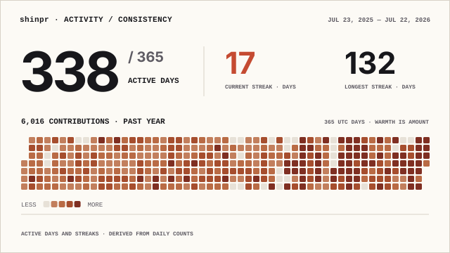
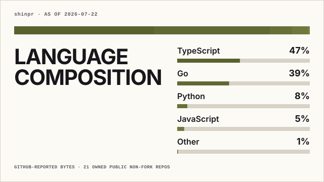
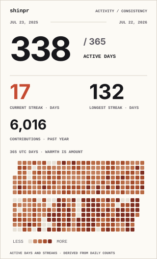
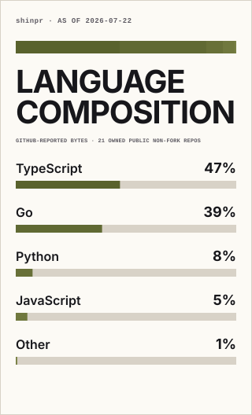

# GitHub Profile Stats

Generate static SVG cards from GitHub API metrics in your own profile repository.

Choose one of three profiles. Each run collects only the data shown by that profile and generates wide and compact cards in both light and dark. The Action uses no hosted renderer or runtime npm packages.

The Action returns all four validated SVGs or fails. The workflow below commits those files as one set, so an unsuccessful run leaves the previously published cards unchanged.

## Card previews

### Signal Field

  <picture>
    <source media="(prefers-color-scheme: dark)" srcset="./assets/signal-field-wide-dark.svg">
    
  </picture>

### Activity consistency

  <picture>
    <source media="(prefers-color-scheme: dark)" srcset="./assets/activity-consistency-wide-dark.svg">
    
  </picture>

### Language composition

  <picture>
    <source media="(prefers-color-scheme: dark)" srcset="./assets/language-composition-wide-dark.svg">
    
  </picture>

Compact cards

  <picture>
    <source media="(prefers-color-scheme: dark)" srcset="./assets/signal-field-compact-dark.svg">
    
  </picture>
  <picture>
    <source media="(prefers-color-scheme: dark)" srcset="./assets/activity-consistency-compact-dark.svg">
    
  </picture>
  <picture>
    <source media="(prefers-color-scheme: dark)" srcset="./assets/language-composition-compact-dark.svg">
    
  </picture>

The preview SVGs are generated for <code>shinpr</code> by the production pipeline and should not be edited by hand.

## Quick start

Add this workflow to <code>.github/workflows/profile-stats.yml</code> in your profile repository. The Actions are pinned to full release commit SHAs.

~~~yaml
name: Update profile stats

on:
  workflow_dispatch:
  schedule:
    - cron: '17 3 * * *'

permissions:
  contents: write

concurrency:
  group: update-profile-stats
  cancel-in-progress: false

jobs:
  update:
    runs-on: ubuntu-latest
    steps:
      - uses: actions/checkout@de0fac2e4500dabe0009e67214ff5f5447ce83dd # v6.0.2
      - uses: shinpr/github-profile-stats@d4fc303c8ccf3510e7daf799c79136dfe35529f0 # v0.1.0
        id: stats
        with:
          username: ${{ github.repository_owner }}
          token: ${{ github.token }}
          profile: signal-field
      - name: Stage complete artifact set
        env:
          READY_DIR: ${{ steps.stats.outputs.ready-dir }}
        run: |
          mkdir -p profile
          cp "$READY_DIR"/signal-field-*.svg profile/
          test -s profile/signal-field-wide-light.svg
          test -s profile/signal-field-wide-dark.svg
          test -s profile/signal-field-compact-light.svg
          test -s profile/signal-field-compact-dark.svg
          git add profile/signal-field-*.svg
      - name: Publish changed artifact set
        run: |
          if git diff --cached --quiet; then
            exit 0
          fi
          git config user.name github-actions[bot]
          git config user.email 41898282+github-actions[bot]@users.noreply.github.com
          git commit -m "Update profile stats"
          git push
~~~

This example generates <code>signal-field</code>. To use another profile, change <code>profile</code> and the four filenames in the staging step. A standalone copy is available at <a href="examples/profile-workflow.yml">examples/profile-workflow.yml</a>.

Reference one generated layout from the profile README and let <code>&lt;picture&gt;</code> select the color scheme:

~~~html
<picture>
  <source media="(prefers-color-scheme: dark)" srcset="./profile/signal-field-wide-dark.svg">
  
</picture>
~~~

Replace <code>wide</code> with <code>compact</code> in both paths to use the compact layout.

## Profiles and generated files

| Profile | Displays |
|---------|----------|
| <code>signal-field</code> (default) | Contributions, stars, authored pull requests and issues, and daily activity |
| <code>activity-consistency</code> | Active days, current and longest streaks, contributions, and daily activity |
| <code>language-composition</code> | GitHub-reported language bytes across owned public non-fork repositories |

Every profile generates the same four variants:

~~~text
<profile>-wide-light.svg
<profile>-wide-dark.svg
<profile>-compact-light.svg
<profile>-compact-dark.svg
~~~

All four variants from one run use the same collection date and metric values.

## Inputs

| Input | Required | Default | Meaning |
|-------|----------|---------|---------|
| <code>username</code> | Yes | — | GitHub login to summarize |
| <code>token</code> | Yes | — | Calling workflow's <code>${{ github.token }}</code> |
| <code>profile</code> | No | <code>signal-field</code> | <code>signal-field</code>, <code>activity-consistency</code>, or <code>language-composition</code> |

## Metric definitions

- Contributions are the GitHub GraphQL contribution-calendar counts visible to the workflow token for the inclusive past 365 or 366 UTC dates. Exact parity with the GitHub profile page is not promised.
- Active days and streaks are derived from those daily counts. Current streak means consecutive active UTC days ending on the collection date; longest streak is bounded to the displayed period.
- Stars are summed across owned public repositories.
- Pull requests and issues are the all-time authored-public totals reported by GitHub REST Search. Search examines at most 4,000 matching repositories, so these are GitHub Search values rather than an independent exhaustive crawl. See <a href="https://docs.github.com/en/rest/search/search#search-scope-limits">GitHub's search scope limits</a>.
- Language composition aggregates GitHub-reported byte counts across owned public non-fork repositories, including archived repositories. Repositories with no reported language still count toward the repository total but add no bytes. An incomplete repository scope fails rather than displaying a subset.

## Limits and update behavior

- The supported credential is the calling workflow's <code>${{ github.token }}</code>. PATs and authentication fallbacks are not supported.
- Cards update only when the workflow runs and commits changed SVGs. There is no live renderer or hosted service.
- A generation run has a 10-minute deadline. A timeout or incomplete metric produces no publishable file set.
- <code>signal-field</code> supports fewer than 2,000 owned public repositories for its star total. A larger scope fails instead of displaying a subtotal.
- Stars, authored pull requests and issues, and language composition use public-repository data. Contribution visibility follows the result returned to the workflow token.

## Development

Requires Node.js 24 or later. The Action itself uses GitHub's Node.js 24 runtime.

~~~sh
npm test
npm run check
~~~

The project has no runtime or development package dependencies.
